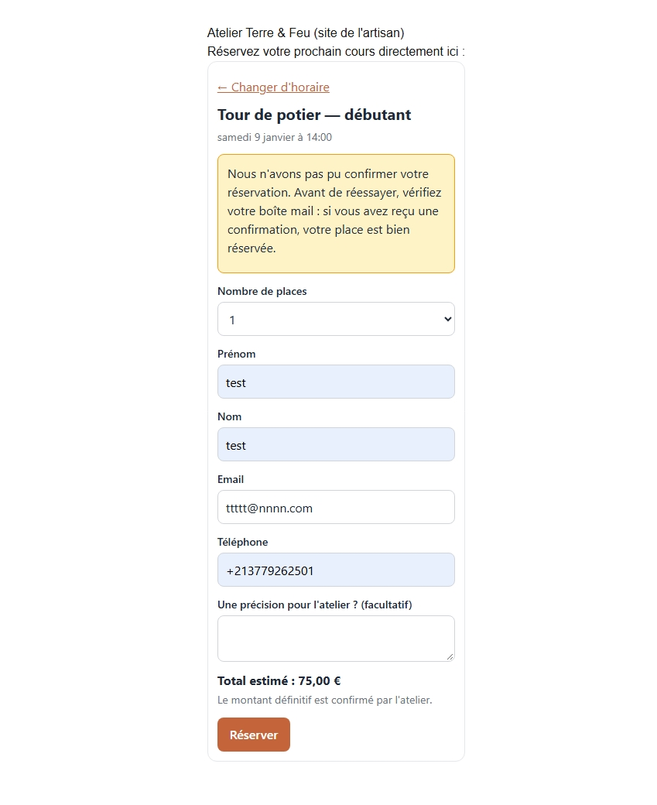
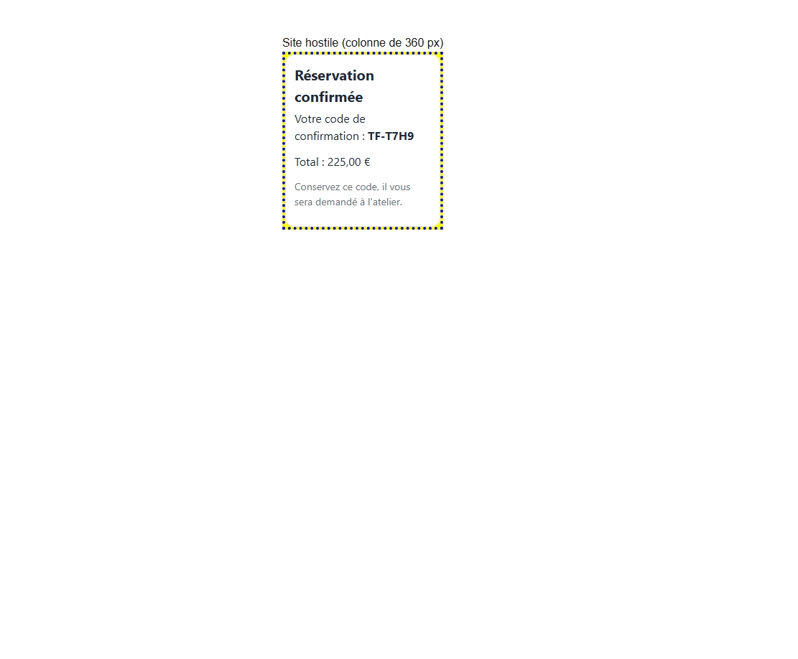
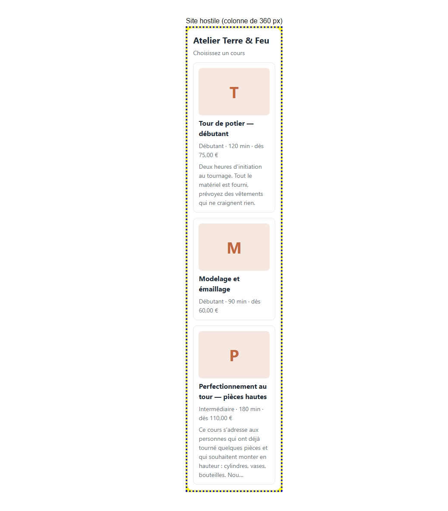
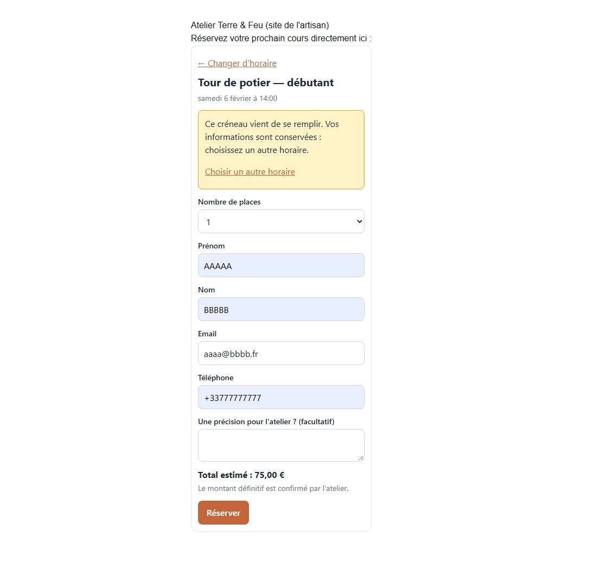

# Widget de réservation Daisy (sujet B)

**En ligne :** https://daisy-widget-fawn.vercel.app (pages de test : `/test-hosts/normal` et `/test-hosts/hostile`)

## Pourquoi le sujet B

1. **C'est le sujet le plus proche de l'utilisateur final.** Je peux voir moi-même si ça marche ou si c'est cassé (une page hostile, une place prise, un délai dépassé), et pas seulement lire des logs.
2. **Il force à décider avec des contraintes que je ne contrôle pas** : le CSS du site, le réseau, le temps de réponse de l'API. Les choix sont des arbitrages (isolation contre personnalisation, sécurité contre confort).
3. **Il colle à ma stack** (TypeScript, Next.js) et il tient dans 4 à 6 h avec un tunnel complet de bout en bout. Je préférais un rendu fini et compris à un sujet plus ambitieux que je n'aurais pas pu défendre.

## 1. Lancer le projet

**Prérequis :** Node 20 ou plus récent.

```bash
npm install                                   # projet Next.js (mock de l'API + pages de test)
cd widget && npm install && npm run build     # construit le widget dans public/v1.js
cd .. && npm run dev                          # http://localhost:3000
```

Le widget appelle par défaut l'API sur le même domaine que celui d'où vient `v1.js` (par exemple `http://localhost:3000/v1.js` donne `http://localhost:3000/api/public/v1`). S'il n'arrive pas à lire l'adresse du script, il prend `http://localhost:3000/api/public/v1`. L'attribut `data-api` de la balise de montage reste prioritaire pour indiquer une autre adresse. `npm run dev` dans `widget/` relance le build à chaque modification (`vite build --watch`).

**Pages de test :**

- `/test-hosts/normal` : un site d'artisan ordinaire (colonne de 640 px).
- `/test-hosts/hostile` : une colonne de 360 px avec un CSS agressif (`!important` sur `button`, `input`, `div`, `p`, etc.) pour vérifier l'isolation du widget.

**Outils de test du mock :**

- `GET /api/mock/reset` : remet les créneaux et les réservations à leur état initial (les données sont en mémoire).
- `GET /api/mock/fail?mode=...` : déclenche une panne pour la **prochaine** réservation uniquement. La panne est consommée par le prochain `POST /bookings`, quel qu'il soit.
- Sur `POST /api/public/v1/bookings` :
  - `?delay=0` : supprime la latence simulée (sinon 1,5 à 4 s). Accepte une durée en millisecondes.
  - `?fail=...` : déclenche la panne directement sur cette requête (prioritaire sur le mode posé par `/api/mock/fail`).

**Modes de panne** (lus dans `app/api/public/v1/bookings/route.ts`) :

| Mode | Réponse |
| --- | --- |
| `origin_not_allowed` | 403 `{ "error": "origin_not_allowed" }` |
| `rate_limited` | 429 `{ "error": "rate_limited" }` |
| `server_error` | 500 `{ "error": "server_error" }` |
| `slot_cancelled` | 409 `{ "error": "slot_cancelled" }` |
| `slot_full` | 409 `{ "error": "slot_full", "available": N }` ; N vient de `?available=N` sur la requête, 0 par défaut |
| `hang` | la réservation est enregistrée (les places baissent), puis la réponse est retardée de 20 s, au-delà du délai de 15 s du widget |

## 2. Ce que j'ai livré

**Mock de l'API publique** (Next.js, App Router, routes dans `app/api/`) :

- `GET /api/public/v1/studio` : nom, fuseau horaire, devise, couleur principale, règles de réservation (téléphone obligatoire, 4 places maximum).
- `GET /api/public/v1/courses` : trois cours, dont un sans image ni description et un avec une description très longue.
- `GET /api/public/v1/courses/{course_id}/slots?from=...&to=...` : créneaux d'un cours, fenêtre de 90 jours maximum (erreurs `course_not_found`, `invalid_date`, `window_too_large`).
- `POST /api/public/v1/bookings` : vérifie la demande (`invalid_json`, `slot_not_found`, `invalid_seats`, `too_many_seats`, `invalid_customer`, `phone_required`), refuse avec `slot_full` s'il n'y a plus assez de places, sinon décompte les places et renvoie un code de confirmation.
- `GET /api/mock/reset` et `GET /api/mock/fail` (voir section 1).

**Le widget** (`widget/`, construit dans `public/v1.js`) : un seul fichier de 26,8 kB, soit environ 11 kB compressé en gzip. Il se monte dans `<div id="daisy-booking">` et se charge avec une simple balise `<script>`.

**États gérés** (dans `widget/src/App.tsx`) :

- Démarrage : chargement ; erreur avec bouton « Réessayer ».
- Liste des cours : aucun cours proposé ; image manquante ou qui ne charge pas (remplacée par une pastille avec l'initiale) ; description longue raccourcie.
- Créneaux : chargement ; erreur avec « Réessayer » ; aucun créneau sur la période ; créneau complet (désactivé) ; « Dernière place » ; passage à la fenêtre suivante (89 jours à chaque fois, sans sauter de jour).
- Formulaire : nombre de places limité au plus petit entre le maximum de l'atelier et les places restantes ; téléphone obligatoire ou facultatif selon l'atelier ; total estimé ; bouton désactivé pendant l'envoi et protection contre le double-clic (une seule requête part).
- Erreurs de réservation, avec les informations saisies conservées :
  - `slot_full` avec des places restantes : proposition de réserver ce nombre de places, ou de choisir un autre horaire ;
  - `slot_full` sans place restante, ou `slot_cancelled` : proposition de choisir un autre horaire ;
  - erreurs de validation : invitation à vérifier les coordonnées ;
  - `rate_limited` : invitation à réessayer plus tard ;
  - `origin_not_allowed` : message au client et explication dans la console pour l'atelier ;
  - toute autre erreur (500, réseau coupé, délai dépassé) : message d'incertitude, qui invite à vérifier ses e-mails avant de réessayer, car la réservation a peut-être été enregistrée.
- Confirmation : code de confirmation et total.

Délais côté widget : 8 s pour les lectures, 15 s pour la réservation.

**Pages de test :** `/test-hosts/normal` et `/test-hosts/hostile`.

**Vérification :** il n'y a pas de tests automatiques. J'ai vérifié à la main :

- le tunnel complet, du choix du cours à la confirmation ;
- une place prise par quelqu'un d'autre pendant la saisie ;
- le double-clic sur « Réserver » (une seule requête part) ;
- le délai dépassé (le widget affiche l'incertitude alors que la réservation existe côté serveur) ;
- l'isolation CSS sur la page hostile.





## 3. Choix d'architecture et écarts de stack

- **Mock en Next.js avec pannes déclenchables.** Les routes reproduisent l'API publique, avec des données en mémoire. Chaque panne du sujet peut être provoquée à la demande (`/api/mock/fail`, `?fail=`, `?delay=`), ce qui permet de tester les cas difficiles sans attendre qu'ils arrivent.
- **Widget en bundle séparé, Preact + Vite.** Le site de l'artisan ne charge qu'un seul fichier, `v1.js` (format IIFE : tout est dans une fonction qui s'exécute seule, le bundle n'expose aucune variable globale). Preact est léger, et le widget embarque sa propre copie : il n'entre pas en conflit avec un React ou un jQuery déjà présent sur la page hôte. *Coût :* deux outils de build (Next.js et Vite) et deux `package.json` à maintenir.
- **Shadow DOM plutôt qu'iframe.** Le widget s'adapte à la hauteur de son contenu et à la largeur de la page sans communication entre fenêtres, et le CSS de l'hôte ne s'applique pas à ses éléments. *Limites :*
  - les propriétés héritées (police, couleur, taille de texte…) traversent quand même le Shadow DOM, d'où `all: initial` sur `:host` et `.dw-root` ;
  - la boîte de montage (`#daisy-booking`) fait partie de la page : elle reste soumise au CSS de l'hôte (bordures, marges, fond…).
- **Pas de Supabase.** Le widget n'appelle qu'une API publique. Le mock garde ses données en mémoire, et `/api/mock/reset` les remet à zéro.
- **Pas de Tailwind dans le widget.** Les styles doivent vivre à l'intérieur du Shadow DOM. Un CSS simple, écrit à la main dans `widget/src/styles.ts`, y est injecté au montage. Tailwind reste installé côté Next.js, mais le widget ne l'utilise pas.
- **Vercel pour la démo.** Le mock et les pages de test sont déployés sur Vercel, qui construit le projet Next.js depuis GitHub. Vercel ne compile pas `widget/` : `public/v1.js` est commité tel quel, donc après chaque changement du widget il faut lancer `npm run build` dans `widget/`, puis commiter.

## 4. Les quatre questions du sujet

### 4.1 CSS agressif du site hôte
Le widget vit dans un Shadow DOM : le CSS du site n'y entre pas et le mien n'en sort pas. Ça ne suffit pas : certaines propriétés passent quand même (la police, `text-transform`...). J'ai donc mis `all: initial` sur `:host` (la boîte dans la page) et sur `.dw-root` (le premier élément dans le Shadow DOM), qui remet tout à zéro. J'utilise des `px` et pas des `rem`, pour qu'un site qui change la taille de sa page ne déforme pas le widget. Pour les largeurs, j'utilise `@container` (la largeur de la colonne où il est posé) plutôt que la largeur de l'écran.

Je l'ai testé sur `/test-hosts/hostile` : le site force du rouge sur fond jaune, du Comic Sans, du texte en majuscules et des bordures, avec `!important`. Le widget reste propre.



**Le prix :** le widget ne reprend pas la police du site et ne peut pas être stylé de l'extérieur. Le CSS est dans un texte JavaScript (le bundle fait 26,8 kB, environ 11 kB en gzip). Il faut des navigateurs récents. Et la boîte `#daisy-booking` elle-même reste soumise au CSS du site, donc un site qui la cache ou la déforme gagne.

### 4.2 Personnalisation
Ce que l'atelier peut changer : sa couleur principale (`primary_color` dans l'API), qui devient une variable CSS. Rien d'autre : pas de CSS libre, pas de choix de mise en page, de tailles ou de textes.

Pourquoi cette limite : avec 70 ateliers, chaque réglage libre est une version de plus à tester et à maintenir, et chaque atelier peut casser l'accessibilité sans le savoir (une couleur claire sur du blanc). Pour « moche sur mobile » : c'est un défaut du widget, qu'on corrige pour les 70 d'un coup (c'est le rôle de `@container`), pas un réglage par atelier.

Pas implémenté : un garde-fou de contraste (si la couleur est trop claire, la foncer ou prendre la couleur par défaut) et une courte liste de polices au choix. Ce serait la suite logique.

### 4.3 Dernière place prise pendant la saisie
Les champs ne sont jamais vidés. Un cadre jaune apparaît au-dessus du formulaire.

- Plus aucune place : « Ce créneau vient de se remplir. Vos informations sont conservées : choisissez un autre horaire. » avec le lien « Choisir un autre horaire ».
- Quelques places restent : « Il ne reste que N place(s) sur ce créneau, et vous en demandiez X. Vous pouvez réserver N place(s) ou choisir un autre horaire. Vos informations sont conservées. » avec le bouton « Réserver N place(s) ».

Le message dit ce qui s'est passé, ne culpabilise pas, rassure sur les données et propose la suite.



### 4.4 Indicateur de bon fonctionnement
Rien n'est implémenté, je décris ce que je mettrais. L'indicateur principal : le taux de conversion par atelier, c'est-à-dire les réservations confirmées sur les chargements du widget, avec l'entonnoir étape par étape (widget affiché, cours choisi, créneau choisi, formulaire commencé, formulaire envoyé, confirmé). C'est aussi ce qui répondrait au ticket « 60 % d'abandon aux coordonnées ».

Indicateurs de santé : le taux d'erreur par type (surtout `origin_not_allowed`, car l'énoncé dit qu'un artisan sur trois oublie de déclarer son domaine), le taux de « réservation incertaine » (délai dépassé), les `429` et les `5xx`, et le temps avant l'affichage des cours. Les événements seraient anonymes, sans nom ni e-mail.

## 5. Limites connues et ce que je n'ai pas fait

J'ai choisi de traiter d'abord ce qui peut faire perdre de l'argent ou la confiance d'un client : éviter une double réservation, ne pas annoncer un échec quand la réservation est peut-être passée, et ne pas casser le site de l'artisan. Voici ce que je n'ai pas fait ou pas testé.

**Ce que le widget ne fait pas**
- Il ne lit pas l'attribut `data-studio` (la clé publique de l'atelier). Mon API de test n'a qu'un seul atelier, donc la clé n'est envoyée nulle part.
- Il ne gère pas le bouton « retour » du navigateur : les écrans changent en interne sans créer d'historique.
- Il n'affiche pas `logo_url` ni `cancellation_hours`, alors que l'API me les renvoie.
- Il n'y a qu'un widget par page, dans une boîte `#daisy-booking` présente au chargement. Je n'ai pas prévu de le relancer à la main sur une page qui change sans se recharger.
- Le bouton « Voir les créneaux suivants » n'a pas de limite, et il n'y a pas de bouton « précédents ».
- Le widget est seulement en français, avec les prix au format fr-FR.
- Les erreurs `slot_not_found` et `invalid_json` affichent le message d'incertitude, alors que ce sont des refus certains. Je les ai laissées comme ça faute de temps.
- Il doit être chargé avec une balise `<script>` classique (pas `type="module"`), car je lis `document.currentScript` pour trouver l'adresse de l'API. Sinon, on passe `data-api`.

**Ce que je n'ai pas testé**
- Je n'ai testé le widget que sur mes deux pages (une normale, une avec du CSS hostile), pas sur un vrai Wix, Squarespace ou WordPress.
- Je n'ai pas testé le cas où la page et l'API sont sur deux domaines différents : mon API de test n'envoie pas d'en-têtes CORS. Avec la vraie API, c'est Daisy qui autorise les domaines (sinon `403 origin_not_allowed`, que le widget gère : message neutre au client, explication dans la console pour l'artisan).
- Je n'ai pas vérifié ce qui se passe si le délai d'une fonction Vercel est dépassé pendant le mode `hang` (20 s).
- Je n'ai pas testé avec un lecteur d'écran. L'accessibilité se limite aux zones cliquables de 44 px, aux champs de 16 px, au contour visible au clavier et au `role="alert"` sur les messages.
- Il n'y a pas de tests automatiques : j'ai tout vérifié à la main (réservation, place prise, double clic, délai dépassé, CSS hostile).
- Les navigateurs doivent être récents (2023 et après) à cause de `@container` et de `color-mix`.

**Les limites de mon API de test**
- Les données sont gardées en mémoire. Elles reviennent à l'état de départ quand le serveur redémarre, et sur Vercel ça peut arriver sans prévenir. `/api/mock/reset` les remet aussi à zéro.
- `/api/mock/reset` et `/api/mock/fail` sont en GET pour pouvoir les lancer depuis la barre d'adresse. Dans une vraie API, ce serait du POST.
- Les images des cours sont volontairement absentes ou cassées, pour montrer que le widget affiche une pastille avec l'initiale à la place.

**Pas implémenté, seulement décrit dans la section 4**
- Le contrôle du contraste de la couleur de l'atelier, la liste des polices autorisées et les événements pour mesurer l'abandon du parcours.

**Taille du widget** : 26,8 kB, soit environ 11 kB une fois compressé en gzip.

## 6. Suppositions faites

Les points ci-dessous ne sont pas clairs dans l'énoncé ou dans l'API. J'ai fait un choix pour avancer, et je dis lequel.

**Sur les données**
- Une image de cours peut manquer (`image_url` vaut `null`) ou ne pas se charger. J'ai supposé que ça arrive souvent chez les artisans, donc le widget affiche une pastille avec l'initiale.
- Le prix est en centimes. Je ne divise par 100 qu'à l'affichage. Le total affiché dans le formulaire est une estimation : c'est celui du serveur qui fait foi.
- Les horaires sont affichés dans le fuseau de l'atelier, pas dans celui du visiteur. J'ai supposé qu'une cliente qui réserve à Paris depuis Montréal doit voir l'heure à laquelle le cours a lieu à Paris.
- Le champ `to` de la recherche de créneaux : dans mon API de test, une date seule est comprise comme minuit UTC, donc le jour `to` lui-même n'est pas inclus. Je ne sais pas comment l'API réelle le traite. Pour ne sauter aucun jour, le widget avance de 89 jours, la même durée que sa fenêtre.

**Sur les erreurs**
- J'ai supposé que les erreurs de l'API ont toutes la forme `{ "error": "code" }`. Si le corps est vide ou illisible, le widget le traite comme une erreur inconnue.
- Pour les cas que l'énoncé ne décrit pas, j'ai choisi des codes : `404 slot_not_found`, `400 invalid_json`, `422 invalid_customer`.
- Si je n'ai reçu aucune réponse à une réservation (délai de 15 secondes dépassé), je ne sais pas si elle est passée. Le widget ne relance donc jamais tout seul, il dit à la cliente de vérifier ses e-mails.

**Sur la sécurité**
- J'ai supposé que la clé publique de l'atelier n'est pas un secret : elle est visible dans le code de la page de l'artisan, donc elle ne protège rien toute seule.

**La question que j'aurais posée à l'équipe**
- L'API accepte-t-elle une clé d'idempotence sur `POST /bookings` ? Sans elle, deux envois identiques créent deux réservations. J'ai donc bloqué le double clic dans le widget et désactivé le bouton pendant l'envoi, mais cela ne protège pas contre un envoi depuis deux onglets ou un renvoi après une panne réseau.

## 7. Partie 2
### 7.1 Journal de bord
Voir [JOURNAL.md](JOURNAL.md).

### 7.2 Classement des tickets (du plus d'envie au moins)
1. Ticket 5 (60 % d'abandon dans le widget)
2. Ticket 1 (le partenaire a changé le format des dates)
3. Ticket 7 (l'export comptable ne correspond pas aux relevés)
4. Ticket 2 (le calendrier rame à 200 cours)
5. Ticket 6 (API publique pour les partenaires)
6. Ticket 4 (filtre par type de cours)
7. Ticket 3 (paiement TPE sur place)
8. Ticket 8 (design system)

Ce que ça dit de moi : je pars d'abord vers les problèmes où il faut comprendre avant de coder et où l'effet se voit chez de vraies personnes (5, 1, 7). Je suis moins attiré par les tâches déjà bien définies (4, 3, 8), même si je sais qu'elles sont utiles. Mon classement dit mon envie, pas ce qui est le plus important : je prendrais le ticket 1 avant tout le reste s'il bloque les clients.

### 7.3 Mes deux premières semaines
**Semaine 1 : comprendre, sans rien casser.**

- Installer le projet et le faire tourner, noter ce qui bloque.
- Lire le code des parcours principaux (réservation, planning) et la façon de déployer et de revenir en arrière.
- Regarder les erreurs récentes (monitoring) et les 5 derniers tickets du support.
- Une demi-heure avec chaque développeur : ce qui fait mal, ce qu'ils ne veulent pas toucher.
- Livrer une petite correction, pour passer toute la chaîne de la relecture au déploiement.

**Semaine 2 : choisir une chose utile.**

- Écouter ou lire des retours de 2 ou 3 artisans.
- Proposer à Charlotte une amélioration petite et mesurable (par exemple suivre l'abandon du tunnel), avec ce que je ne ferai pas.
- Ne rien réécrire : le produit a 4 ans de code et 70 clients qui s'en servent tous les jours.

### 7.4 Ma question
Est-ce que `POST /bookings` accepte une clé d'idempotence ? Sans elle, deux envois identiques créent deux réservations.

Ce que j'ai supposé : elle n'existe pas. J'ai donc bloqué le double clic dans le widget (un verrou et un bouton désactivé) et je ne relance jamais tout seul après un délai dépassé. Ça ne protège pas d'un envoi depuis deux onglets.
